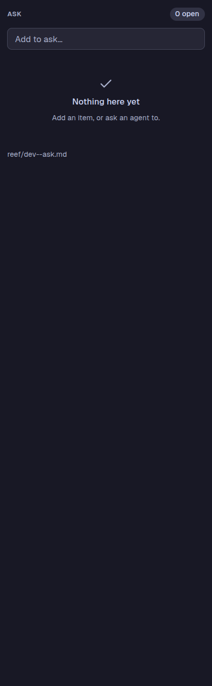

# Workspace Scratchpad

A small to-do list for each Orca workspace, in the right sidebar, that your agents can edit too.



Each list is a plain Markdown file. You tick and add items in the panel; agents read and edit the
same file with ordinary file tools. There is no MCP server, skill or extra capability involved.

## Who this is for

I built Scratchpad for my own setup, and it makes choices that suit it:

- The Orca **desktop app** runs on my laptop. Most workspaces and agents live on a
  headless **Orca server** (`orca serve`) on another machine, which the desktop pairs with.
- Plugins run only in the desktop app, and the plugin API can't read files inside a workspace on
  another host. So the lists live in a folder that **Syncthing** shares between the two machines.
  The panel edits its copy, agents on the server edit theirs, and Syncthing keeps them in step.

If you use Orca on one machine, there is nothing to sync, and the default folder just works.
If your setup is like mine, you need some folder sync (Syncthing, or anything else that
mirrors a folder) between the desktop and each server. If neither fits, the code is small and
MIT-licensed, so adapt it. [docs/DESIGN.md](docs/DESIGN.md) explains the reasoning and the Orca
quirks the code works around.

## How it works

```
<folder>/<host>/<slug>.md           one list per workspace, e.g. devbox/dev--myapp.md
                                    for /home/me/dev/myapp on the host "devbox"
<folder>/<host>/folder-<id>.md      folder workspaces (such as bots), keyed by Orca's id
```

- `<folder>` is the **Scratch folder** setting (default `~/Sync/orca-scratch`). It must be the
  same path on every machine.
- `<host>` is the machine the workspace lives on, as its short hostname (`hostname -s`).
  The desktop can't see a paired server's hostname, so the first time you open a workspace there,
  the panel asks you for it once.
- `<slug>` is the workspace path after your home folder, with `/` turned into `--`.

Top-level `- [ ]` / `- [x]` bullets are items. Any other lines (headings, notes) are left alone
and shown under "Notes". Every edit from the panel is checked against the line's previous text.
If an agent or a sync changed the file in the meantime, the panel reloads instead of overwriting.

In my setup the laptop is `marlin` and the server is `reef`. Lists live in `~/Sync/orca-scratch`
on both machines, which Syncthing shares with its watcher delay lowered to 1 s, so an edit on one
side shows up on the other in about 2–3 seconds.

## Install

```sh
orca plugin install thisisryanswift/orca-scratchpad
```

Orca shows the access it asks for and the command to approve it:

- `workspace:read`: which workspace is focused, and its path and host.
- `storage:own`: remembers the hostnames you entered for paired servers.
- `settings:own`: the Scratch folder setting.

It asks for no terminal, agent or network capabilities. Like any `trusted-worker` plugin, its worker
is a Node.js process running as your user. Its code reads and writes files only under the Scratch
folder and makes no network calls; `src/worker.ts` is short enough to check.

## Set up agents

`agent/scratch` is a small bash script that works out the current workspace's list path using the
same rules as the panel. Copy it into the synced folder so every machine has it:

```sh
mkdir -p ~/Sync/orca-scratch/bin
cp agent/scratch ~/Sync/orca-scratch/bin/scratch
```

```sh
scratch          # path of this workspace's list
scratch show     # print it
scratch add fix the flaky test
```

Inside an Orca agent session, the script asks Orca which workspace the session belongs to
(`orca agent show $ORCA_AGENT_SESSION_ID`). That's how bots find their list. Elsewhere it uses the
git root or the current directory. Set `ORCA_SCRATCH_DIR` if your folder isn't
`~/Sync/orca-scratch`.

Then tell your agents about it in `AGENTS.md` / `CLAUDE.md`, globally or per project:

```md
- This workspace has a shared scratchpad list the user sees in Orca. Find it with
  `~/Sync/orca-scratch/bin/scratch` (prints the path). It is Markdown: `- [ ] item` / `- [x] done`.
  Read it when starting work; tick items you finish; add `- [ ] @me ...` for things you need
  the user to do. Leave other lines alone.
```

## Limits

- All paired servers whose hostname the desktop can't see share one saved name. With two paired
  servers, the panel can't tell them apart (see [DESIGN.md](docs/DESIGN.md)).
- If two people or agents edit the same line within the sync window, Syncthing makes a
  `.sync-conflict` copy of the file.
- Items are single lines.

## Develop

```sh
orca plugin types .        # once, for tsc
orca plugin test .
orca plugin check .
orca plugin dev watch .    # loads this folder into the desktop app; Ctrl-C unloads it
```

These must run where the Orca desktop app runs. A headless `orca serve` has no plugin service.
[AGENTS.md](AGENTS.md) has the checks a change must pass, and how I test from a server checkout.

## License

[MIT](LICENSE)
